# Objective

Become familiar with the basic functions of **ANSYS DesignModeler** (geometry creation) and **ANSYS Meshing** (domain discretisation), and their interaction with **ANSYS Fluent** (flow calculations) within and outside the Workbench environment.

Further information is available in the ANSYS Workbench help or at [ANSYS Workbench](https://ansyshelp.ansys.com/).

# Getting Started: The Workbench Environment

## Introduction
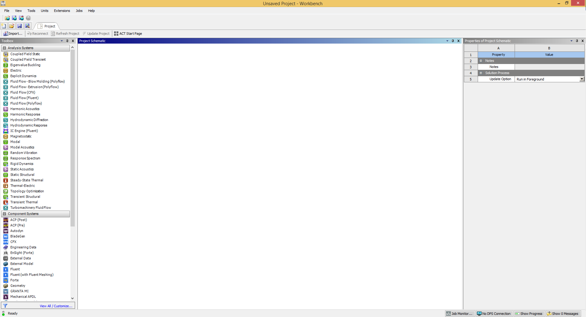

The main Workbench window consists of a toolbox panel (on the left) and the project schematic window (the main part of the window).
The toolbox is divided into five tabs, of which the first two are needed to begin basic work in Workbench.
The **Component Systems** tab lists the applications available within the Workbench environment.
The **Analysis Systems** tab contains a set of standard analysis systems composed of the components described above.

#### Starting Work with a Predefined System

To begin, drag **Fluid Flow(Fluent)** into the highlighted area of the project schematic window (Fig. 2). This method of creating projects will be used in all laboratory sessions.

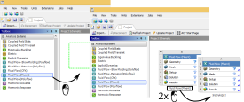

As can be seen, the added block contains the complete set of modules from the **Component Systems** tab, which allows a full numerical analysis to be performed, from geometry creation and domain discretisation to post-processing.
Click the label *Fluid Flow(Fluent)* below the created block and **rename** it to Instrukcja N, where N is the number of the laboratory instructions.
For the purposes of this laboratory course, **this is the standard way** of creating subsequent analyses.

---

#### Creating Custom Systems (Alternative)

Expand

Sometimes, for example in large computational projects, an analysis system requires a tailored approach.
In such cases, the full functionality of the project schematic window can be used.
Creating the first element of the schematic is the same as in the previous approach.
Drag the required block from **Component Systems** and drop it into the highlighted area of the **Project Schematic**.

Each subsequent component can be added in either of two ways.

- The first method is to drop the new component anywhere in the schematic and connect the two components by dragging a cell from one component to the corresponding cell, with the same name, in the other component (Fig. 3a).
- The second method is to drop the new component onto a highlighted cell of a previously added component (Fig. 3b).

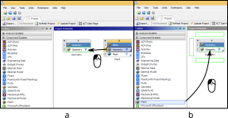

In this way, large project schematics can be created (Fig. 4).

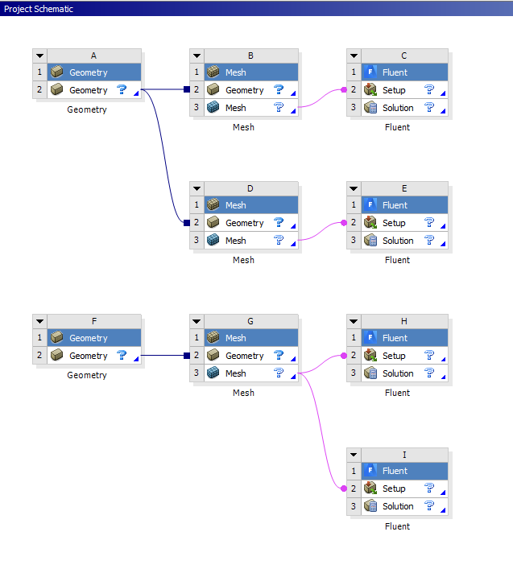

---

#### Symbols in System Component Cells

Expand

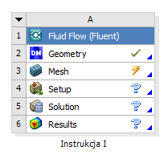

**Individual application cells may have different states, depending on user activity:**

 - *Unfulfilled* - Data from preceding cells are required. Cells in this state may not open.

 - *Refresh required* - Data in preceding cells have changed since the last state.

 - *Attention required* - In this state, the application will not return any data to subsequent cells until the missing information has been supplied.

 - *Update required* - Internal data have changed, but the application has not passed the result to the Workbench environment. Update the cell to synchronise the data.

 - *Up to date* - The data are current and no errors have been detected.

 - *Input changes pending* - The cell is up to date, but may change because of detected changes in preceding cells.

**States typical of solver applications:**

 - *Interrupted, update required* - The calculation was interrupted. Data generated up to the point of interruption are available, but the results file is empty.

 - *Interrupted, up to date* - The calculation was interrupted. The results file contains data. This state occurs if several calculations are interrupted in succession.

 - *Pending* - A batch analysis is in progress. Operations can be performed in other systems within the project.

**Error states:**

 - *Refresh failed, refresh required*

 - *Update failed, update required*

 - *Update failed, attention required*

---

## Geometry Module - DesignModeler

As part of an introduction to the CAD module, create the geometry required for [Laboratory Instructions II](http://ccfd.github.io/courses/momp_lab02.html).

The geometry to be created is a section of a two-dimensional channel with a step. For the purposes of this exercise, create the geometry using two rectangles:

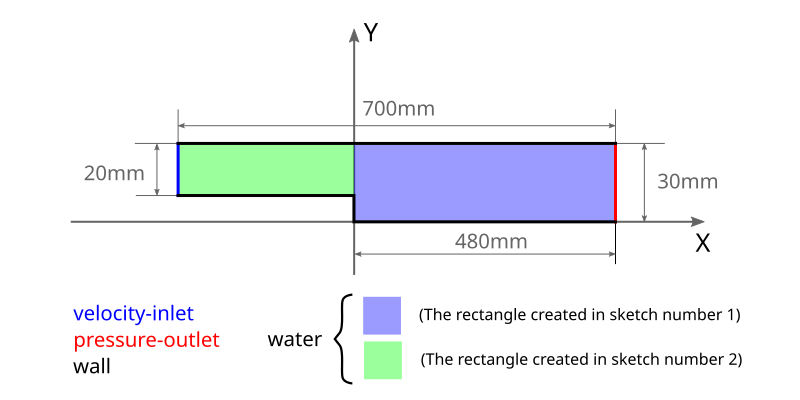

1. Create a project as described in [Starting Work with a Predefined System](#starting-work-with-a-predefined-system).

2. Open DesignModeler by right-clicking the Geometry cell and selecting **New DesignModeler geometry...**. The DesignModeler window consists of three elements: the **graphics window**, the **history tree**, and the **details view**.
The expanded context menu contains items that will be useful during the work:

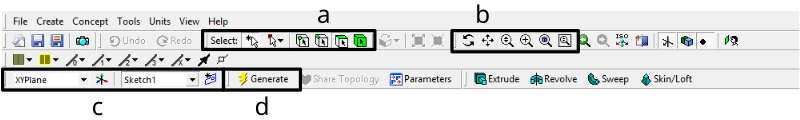

	a. Selection filter menu. This is useful for selecting a specific type of entity (line, surface, etc.).
	b. View manipulation menu for the graphics window. It is also worth learning the keyboard and mouse shortcuts.
		- Pressed mouse wheel — rotate the camera about the origin of the coordinate system.
		- Ctrl + pressed mouse wheel — pan the camera.
		- Shift + pressed mouse wheel — zoom the current view (before using this shortcut, place the cursor over the region to be magnified).
	c. Sketch menu. The blue icon creates a new sketch after the appropriate plane has been selected in the **history tree**.
	d. After each newly inserted operation in modelling mode, create it using the **Generate** button.

3. In the **Units** menu, ensure that the correct units are selected. **Whenever a new application is opened in Workbench, check that the units are set correctly.**

4. Create a **new sketch** (Fig. 6c). Ensure that the correct plane has been selected.

		To align the view with the working plane, click the axis perpendicular to that plane in the coordinate triad shown in the graphics window. In sketching mode, this can also be done with the rightmost button in the context menu (Fig. 6).

5. To enter sketching mode, **select** the newly created sketch in the history tree and open the **Sketching** tab in the same window. A new window with several tabs will appear. Each tab has **two black arrows** for navigation (Fig. 7a). The **Draw** tab contains all the required drawing tools. The **Dimensions** tab contains all dimensioning tools; the **Move** option, used to reposition a dimension, is useful here.

Fig. 7

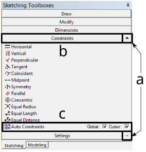

6. After entering sketching mode, enable **automatic constraints** (Fig. 7b and 7c). The software then applies constraints as new elements are added to the sketch and displays the first letter of each constraint. For example, when a horizontal line is drawn, the letter *H* appears, corresponding to the *Horizontal* constraint.

Now proceed to the drawing:

7. In the created sketch, draw the right-hand part of the channel as a rectangle. Apply constraints so that its left edge lies on the Y axis and its lower edge lies on the X axis (**Constraints -> Coincident**). Dimension the rectangle (**Dimensions -> General/Horizontal/Vertical**). A fully dimensioned geometry should appear dark blue.

		It is most convenient to dimension a line by dimensioning the positions of its nodes (endpoints).

8. Leave the sketching mode by clicking the **Modeling** tab.

9. Create another sketch (remember to select the correct plane!). In the new sketch, draw a second rectangle and use the **Coincident** constraint to connect the rectangles at their upper vertices to form the final shape of the channel. **Dimension** the rectangle. Return to **Modeling** mode.

10. At this stage, create the surface that will represent the two-dimensional fluid. Select **Concept -> Surfaces From Sketches**.

Fig. 8.

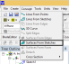

A new menu will appear in the details view:

- **Base Objects**: Select the sketch from which the surface is to be created. It is sufficient to select one of the sketch lines and click **Apply**.
- **Operation**: There are two options:
	- **Add Material**: the created surface will be added to any existing surface in the geometry that it overlaps. There are no other entities in our geometry yet. **Select this option.**
	- **Add Frozen**: the created surface will be added to the geometry as a separate entity.

			Each time a selection is to be accepted and the geometry created,
			click the Generate button (Fig. 6d).

11. Repeat step 10 for the second sketch. This time, select **Add Frozen** (*Generate*).

12. The history tree should now look like this:

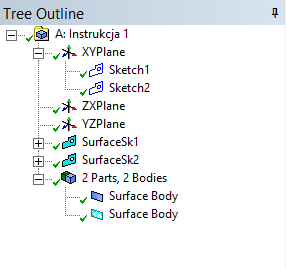

At this stage, two surfaces have been created. In this state, they are treated as two independent, unconnected entities. The two separate surfaces must now be treated as a single part.

13. Expand the last item in the operation history tree. It should contain the two surfaces you created. Hold *Ctrl* and **select** both entries. Right-click to open the menu and select **Form New Part** (Fig. 9a). You have now created a **part**.

Fig. 9.

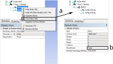

14. In the details of the newly created part, change the geometry type to **Fluid** (Fig. 9b).

15. **Close** DesignModeler.

---

		Before proceeding to the next module, it is good practice to save your work.
		This helps to avoid data loss in the event of a failure or a mistake.

---

## Mesh Module

1. Open the Mesh module by double-clicking the corresponding cell.

2. The interface is very similar to that of DesignModeler: a history tree, a details view, and a graphics window. An additional element is the toolbar at the top of the window.

3. In the history tree, the most important item is the **Mesh** branch. It contains all operations used to generate the computational mesh.
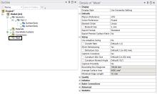

4. To generate the mesh, select **Mesh**, open **Defaults** in the details view, and change the default **Element Size** to **3 mm**.

5. Click **Generate**. A mesh composed of quadrilaterals should appear. Ensure that the upper part of the domain is divided into approximately 10 elements in the vertical direction.

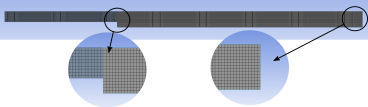

6. The final step is to name the domain entities. This allows boundary conditions to be defined in Fluent. To assign a name, **select** the entities in the graphics window, open the context menu with the **right mouse button**, and select *Create Named Selection...*. **A faster method** is to select the entities (hold *Ctrl* to select several) and press the *n* key.

7. Select the domain entities (edges) in turn and name them as shown in the reference figure in the section ["Geometry Module..."](#geometry-module---designmodeler). Assign a single name, **Woda**, to both surfaces.

8. Close the **Meshing** application.

9. Note that, after closing **Meshing**, the status of the cell is marked as **Update required**. As described in the section ["Symbols..."](#symbols-in-system-component-cells), the application has completed the task locally but has not passed the information to the environment containing the whole project. Right-click the **Mesh** cell and select **Update** from the context menu. Workbench will communicate with the application and update the data.

		While doing so, take a look at the other items in the context menu.
		The reset option is particularly useful.
		If you are not satisfied with your work and/or want to return the whole cell to its initial state, use the reset option.

10. Save the project. The *Instrukcja I* block is now ready for use in Laboratory Instructions II.

### Basic Mesh Quality Controls

Let us examine how the generated mesh can be "improved".

1. In Workbench, add a **Mesh** component to the project schematic and link its geometry to the *Instrukcja I* block. This procedure is described in [Creating Custom Systems (Alternative)](#creating-custom-systems-alternative).
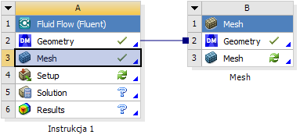
This is a temporary block, which can be deleted after completing the exercise.

2. Open the newly added Mesh cell.

3. Use the options described below to recreate the mesh shown in the figure.

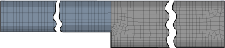

All options described below can be added to the geometry using the **Mesh** tab in the top toolbar. They can also be activated by right-clicking the **Mesh** branch and selecting **Insert** - **Sizing**.
The basic tools for controlling the computational mesh in Meshing that will be introduced at this stage are:

Sizing

**Sizing** - this option allows the number of divisions on an edge or surface to be prescribed.
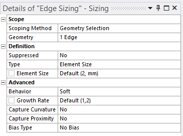
The options of the Sizing function that are of interest at this stage are:

- **Type** - the type of division into elements. The options are to prescribe either the element size or the number of divisions on the selected entity.
- **Bias Type** - an option available for edge division, providing directional refinement of the line.

---

Inflation

**Inflation** - boundary-layer mesh. This option allows a zone of directional refinement to be created on a surface or in a volume. Such zones should be created at the physical walls of the domain.

- **Geometry** - select the surfaces (in a two-dimensional mesh) or the volume (in a three-dimensional mesh).
- **Boundary** - select the edge (2D) or surfaces (3D) at which the boundary-layer mesh is to be created.
- **Maximum Layers** - the number of layers in the boundary-layer mesh.
- For the purposes of these instructions, use the Smooth Transition option (ask the instructor about the other options).

			NOTE: The Inflation option is incompatible with the Mapped Meshing option.

	

---

Mapped Meshing/Face Meshing

**Mapped Meshing** - structured mesh. This option allows rectangles (2D) or prisms (3D) to be used instead of triangles (2D) or tetrahedra (3D).
		Using this option requires several conditions to be satisfied.

- The total number of mesh elements on opposite edges must be the same.
- The geometry should have 4 vertices. For polygons with more than 4 vertices, the software may not be able to identify these vertices; in such cases, they can be defined using the **Specified Corners** option.

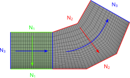

		NOTE: The Mapped Meshing option is incompatible with the Inflation option.

	

---

Advanced Size Functions

**Advanced size functions** - options available in the **Mesh** branch of the history tree, under **Sizing**:
	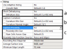

- **Mesh Defeaturing** - an option for ignoring geometric features smaller than:
	- **Defeature Size** - geometric features below this value may be ignored during meshing. Enable this option if the model used for the calculations is to be simplified.
- **Capture Curvature** - a function that refines the mesh in the vicinity of, and on, curved features.
	- **Curvature Min Size** - the minimum mesh element size on a curved feature.
	- **Curvature Normal Angle** - controls the refinement on a curved feature so that the specified angle between the normal vectors of adjacent elements is maintained.
- **Capture Proximity** - enabling this option introduces refinement in narrow gaps.
	- **Proximity Min Size** - if the gap between geometric features is smaller than this value, the function refines the mesh in that region.
	- **Num Cells Across Gap** - the minimum number of mesh elements between adjacent geometric features.

---

# Optional Exercise

- Draw and mesh the geometry shown in the figure using two approaches:
	- Refine the mesh at the walls using the **Inflation** function.
	- Try to generate a similar mesh using **Sizing (with the Bias option)** and **Mapped Mesh**. How should the geometry be prepared to satisfy the requirements for using the **Mapped Mesh** function?
- The inlets are indicated by arrows; the outlet is located at the top of the geometry.
- Yes, these dimensions are in inches.

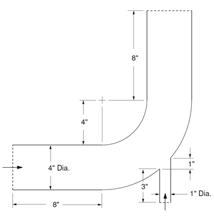
