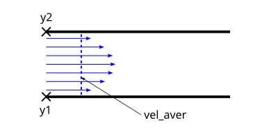
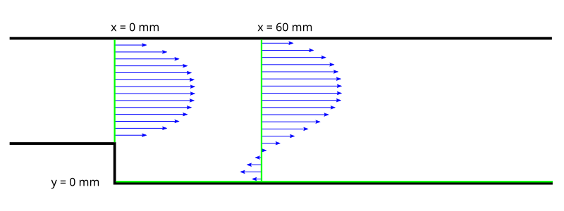
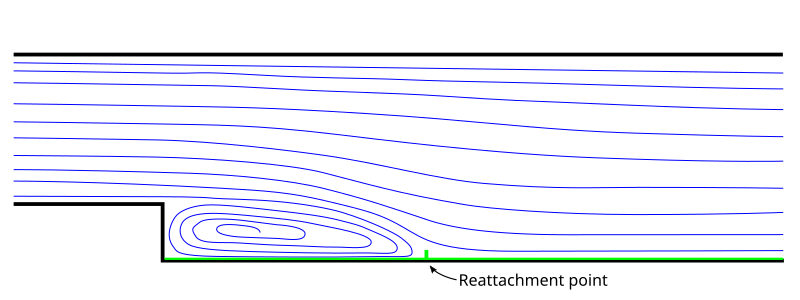

# Objective

Simulate laminar flow through a channel with a backward-facing step and investigate the effects of mesh resolution and the order of approximation of the convective terms in the momentum equations on the quality of the numerical results.

# Overview

In this exercise, simulate **laminar** flow through a channel with a backward-facing step at a Reynolds number of **Reh=230**.
The Reynolds number is based on the **mean inlet velocity** and the **step height**, h = 1 cm.
Perform the simulations on two computational meshes (coarse and fine), using first- and second-order upwind schemes to discretise the convective terms in the momentum equations.
Compare the numerical results with the [experimental data](#experimental-data-description).
Estimate the pressure losses along the channel. Define the parabolic inlet velocity profile using an [interpreted UDF](#preparation-of-the-udf).

**After completing the simulations, consider the following questions:**

1. What causes the local pressure decrease immediately downstream of the step?
2. How does the discretisation scheme for the convective terms affect the numerical results?
3. How does mesh resolution affect the quality of the numerical results?
4. What could explain any discrepancies between the numerical results and the experimental data?

_Completion of the exercise requires presenting the numerical results and their analysis to the laboratory instructor. Submit a report containing both visualisations and an analysis of the results._

# Fluent

## 1. Simulations Using the First-Order Scheme

1. Launch Fluent.
   When Fluent is launched for the first time from the project system, a launcher window appears in which the initial simulation settings can be specified.

2. Select a two-dimensional analysis (the software may detect this setting automatically).
   Additional options that may be useful in subsequent exercises include:

   - **Double precision** — increases numerical precision at the expense of computational speed and stability.
   - **Solver Processes** — specifies the number of processor cores used for the calculation. Increasing the allocated computational resources increases the calculation speed.

   For this exercise, retain the **default settings** for these additional options.

3. The user interface is similar to those of the previously used applications. The *Outline View* tree is located on the left-hand side of the screen. To **configure a simulation case correctly**, work through the tree from top to bottom and specify all required settings.

4. Once Fluent has loaded, the geometry should appear in the graphics window, provided that *Display mesh after reading* was selected, as instructed previously.

   If the geometry is not displayed, click *Display...* in the *Task Page* panel between the graphics window and the outline tree. In the *Mesh display* window, click *Display*.

5. Click **Scale...** to verify that the computational domain has the correct dimensions (0.7 m x 0.03 m).

   If the mesh was generated using units other than those recommended previously, rescale it: select the original units under *Mesh was created in* and confirm by clicking Scale.

6. In the **Task Page** panel, check the basic solver settings:

   a. Pressure-based — recommended for incompressible flow calculations (Density-based — for compressible flow calculations).

   b. Steady — steady-state simulation (Unsteady — transient simulation).

   c. Two-dimensional planar flow: 2D Space/Planar.

7. In **Outline View**, expand **Models** and double-click **Viscous** to open the model selection window. Select the appropriate [model](#overview). Close the window and collapse the Models menu.

8. Define the fluid properties under **Materials**. Expand this item and double-click **air**, or select **air** and click **Create/Edit**.

   Enter the following properties for water:

   - Density: 1000 kg/m3.
   - Dynamic viscosity: 0.001 kg/(m·s).

   In the *Name* field, the material can be renamed from *air* to *woda*. Alternatively, a fluid can be added from the *Fluent Database*; in this case, remember to assign it under *Cell Zone Conditions/Edit*.
   Click **Change/Create** and close the window.

9. Expand **Cell Zone Conditions** and open the settings for the computational domain. Under Fluid, the name assigned to the surfaces should appear; in this case, **Woda**.

   Ensure that the material created in the previous step (**woda**) is selected in the **Material Name** drop-down list.

10. Prepare the [UDF file](#preparation-of-the-udf).

11. Load the prescribed velocity profile into Fluent through User-Defined/Functions/Interpreted in the top menu, and click Interpret.

    

12. Continue to **Boundary Conditions** in **Outline View**.
    Define the boundary conditions here.
    If the geometry entities were named appropriately, Fluent should automatically assign the corresponding boundary condition types.
    Expand the individual boundary conditions and verify the assignments:

    - velocity_inlet — **Inlet** — **velocity-inlet** boundary condition.
    - wall — **Wall** — **wall** boundary condition.
    - pressure_outlet — **Outlet** — **pressure-outlet** boundary condition.

    Boundary conditions are also colour-coded in the graphics window: the inlet is blue, the outlet is red, and the walls are white.

    Open the inlet boundary condition and **activate** the loaded profile for the x-component of velocity at the inlet to the computational domain.
    Note that the profile specifies the x-component of velocity, not the velocity magnitude.
    **Select** the appropriate **Velocity Specification Method**, then select the variable defined in the UDF from the drop-down list for the X component.
    Confirm the selection and close the window.

13. This completes the **Setup** section in **Outline View**.

14. Under **Solution**, open **Methods**:

    - Set the pressure–velocity coupling scheme to **SIMPLE**.
    - Select the first-order scheme for the convective terms in the momentum equations (**Momentum**: **First Order Upwind**).

15. Expand **Monitors** and open **Residual**. Change **Absolute Criteria** from 0.001 to 1e-5 for all residuals.

16. Under **Initialization**, select the Standard initialisation method.
    Select the inlet boundary under Compute from. The inlet values will appear under Initial Values.
    Verify that the velocity corresponds to the mean value specified in the UDF.
    Click Initialize to assign these values throughout the computational domain.

17. Open **Run Calculation**.
    For steady-state calculations, the **number of iterations** is specified under **Parameters**.
    Initially, set 30 iterations and run the calculation. The message **Calculation complete** does not, by itself, indicate that the results are correct.
    Monitor the **convergence history** to obtain a satisfactory level of numerical accuracy.
    **Adjust the number of iterations** and **continue the calculation** until all plotted variables **converge**.
    The calculation may be stopped once **all** plotted variables have converged, i.e. have stabilised **near** the convergence threshold specified in step 15 or have crossed that threshold.
    **When the specified convergence criterion is satisfied**, Fluent displays **! solution converged** in the **Console** at the bottom of the window.

    **Save the convergence plot for inclusion in the report.**

18. The results can now be **visualised**.

19. Generate pressure contours, velocity contours, velocity vectors, and streamlines using **Graphics** under **Results**:

    a. **Contours** — select the required quantity under Contours of. Select **Filled** to fill the regions between contour lines. No selection is required under Surfaces.

    b. **Vectors** — adjust Scale and Skip to improve the readability of the vector plot.

    c. **Pathlines** — select the release surfaces under Release from Surfaces. For finer meshes, remember to specify a value for Path Skip.

    **Include all visualisations in the report.**

20. Define additional sections using Surface/Iso-Surface/Surface of Constant/Mesh.
    Select the X coordinate, followed by the Y coordinate. Create lines at **x = 0**, **x = 0.06**, and **y = 0** by entering the corresponding Iso-Values.

    **Note:** the coordinate values depend on the position of the geometry in the XY plane:

    - x = 0 — cross-section at the step.
    - x = 0.06 — cross-section 60 mm downstream of the step.
    - y = 0 — line along the lower horizontal wall of the channel.

    These numerical values assume that the lower corner of the step is located at the origin of the coordinate system.
    Finally, display the mesh together with the sections to verify that they have been created correctly.

21. Compare the profiles of the x-component of the mean velocity at x = 0 and x = 0.06 with the experimental data using Results/Plots/XY Plot.
    Perform the comparison in Fluent.
    The experimental data are located in the “dane_eksperyment” directory; load them using Load File.
    Click Plot to display the datasets selected under File Data.

    Consider which quantities should be plotted on the X and Y axes.
    To create a plot whose horizontal axis does not represent position, clear Position on x axis.
    Select Position on y axis to plot position on the vertical axis.
    Under X Axis Function, select the x-component of velocity, and under Surfaces, select the relevant section.
    For a horizontal line, set X = 1 under Plot Direction; for a vertical line, set Y = 1.

    Use Write to File to export a dataset to a file.

22. Determine the reattachment location by plotting the x-component of wall shear stress using Display/Plot/XYPlot/Wall Fluxes/X Wall Shear Stress.
    The reattachment point is located where the shear stress changes sign from negative to positive.

    The experimental values are provided in re-vs-reattachment-point_woda_cm.txt. Open the file in Notepad, find the value for the Reynolds number closest to 230, and compare it with the numerical prediction.

23. This stage is now complete. Close Fluent before proceeding to the next stage.

    - Save the case in Workbench.
    - Click the black triangle next to the header of the project system used for this calculation (most likely labelled *A*) and select *Duplicate* from the drop-down menu.

## 2. Simulations Using the Second-Order Scheme

1. Rename the duplicated system Laboratory II.2.

2. Open the Setup cell in the new system.

3. Fluent will launch. Retain the default settings in the launcher window.

4. Change the **discretisation scheme** to Second Order Upwind (step 14 in the preceding section).

5. Run the calculation and compare the results by repeating steps 17–22 (**without reinitialising the solution**).

## 3. Simulations Using the First-Order Scheme on the Fine Mesh

1. Duplicate system A and name it *Laboratory II.3*, following the naming convention used above.

2. To refine the mesh, open **Domain** in the top menu and select **Refine/Coarsening** under **Adapt**.

3. In the window that opens, select **Cell Registers**/**New**/**Region...** and enter the limiting coordinates of the computational domain in the corresponding fields. These coordinates can be checked under **Setup**/**General**/**Scale...**, or under **Domain**, using **Scale...** in the **Mesh** panel.

4. Repeat the first-order calculations (steps 16–21 in Section 1).

## 4. Simulations Using the Second-Order Scheme on the Fine Mesh

1. Duplicate *Laboratory II.3* and name the new system according to the established convention.

   For the fine mesh, select the second-order upwind discretisation scheme and run the calculation (steps 17–22), **without reinitialising the solution**.

---

# Preparation of the UDF

User-defined functions (UDFs) extend the functionality of Fluent.
They can be used to define custom velocity profiles, prescribe physically governed motion of components, or implement custom computational models.

[This link](http://ccfd.github.io/courses/code/momp/UDF_I2.c) provides the source code for prescribing the velocity profile at the inlet to the computational domain.
Download the file to the ANSYS project directory.

In DEFINE_PROFILE, specify:

1. The coordinates y1 [m] and y2 [m] of the lower and upper walls of the inlet channel, respectively.
2. The mean x-component of velocity, vel_aver [m/s], calculated from the prescribed Reynolds number.

After launching Fluent, load the file using Define/User-defined/Functions/Interpreted.

---

# Experimental Data Description

This laboratory exercise uses **experimental data**. Velocity measurements were obtained from an experiment conducted in a channel with the same parameters.

Download the files to the project directory.

- [FILE 1](http://ccfd.github.io/courses/data/momp/2/exper-xvel-re230-xh0_woda_cm.xy) contains the x-component of velocity at the cross-section located at the step.

- [FILE 2](http://ccfd.github.io/courses/data/momp/2/exper-xvel-re230-xh6_woda_cm.xy) contains the x-component of velocity at the cross-section located 60 mm downstream of the step.

- [FILE 3](http://ccfd.github.io/courses/data/momp/2/re-vs-reattachment-point_woda_cm.txt) provides data for determining the reattachment location of the separated shear layer on the lower channel wall at different Reynolds numbers. Select the reattachment location corresponding to the relevant Reynolds number.

