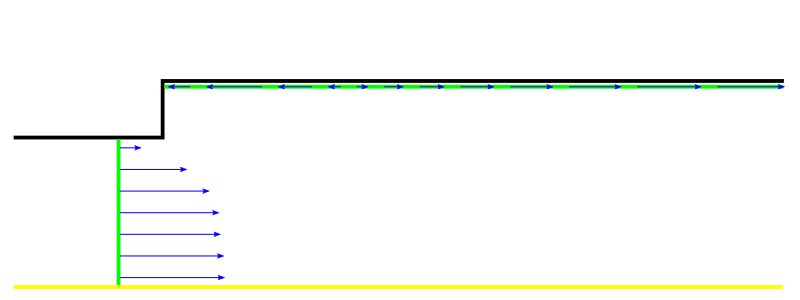

# Objective

Simulate turbulent flow through a pipe with a change in diameter using the k-\(\epsilon\) turbulence model, and investigate the effects of inlet boundary conditions and near-wall modelling on the numerical results.

# Overview

Turbulent flow calculations at ReD = 200 000 using the standard k-\(\epsilon\) turbulence model will be performed on two computational meshes: a baseline coarse mesh and a fine mesh.
The Reynolds number is based on the larger pipe diameter, D = 0.1524m, and the mean velocity at the outlet of the computational domain.

Simulations on the baseline mesh require Standard Wall Functions to calculate the mean velocity, turbulent kinetic energy, k, and turbulent kinetic energy dissipation rate, \(\epsilon\), near the wall.
Calculations on the fine mesh will use the k-\(\epsilon\) turbulence model coupled with the Wolfstein one-equation model in the near-wall region.
This approach is referred to as Enhanced Wall Treatment.

The working fluid is water.

A velocity-inlet boundary condition will be prescribed at the inlet to the computational domain.
The mean velocity profile has been obtained from a simulation of fully developed turbulent pipe flow.
Three approaches to prescribing the inlet profiles of turbulent kinetic energy and its dissipation rate will be considered:

1. Profiles obtained for fully developed pipe flow (inlet_profile_keps.prof).
2. The default Fluent settings, which have no physical significance.
3. User-defined values based on estimates of the turbulence intensity, Tu [%], and the turbulent length scale, lt [m].

Pre-prepared *.cas files containing the coarse and fine computational meshes are provided.
Mesh generation is therefore not required.

*Completion of the exercise requires presenting the numerical results and their analysis to the laboratory instructor. Submit a report containing both visualisations and an analysis of the results.*

# Procedure

## Calculations Using Wall Functions

1. Drag **Fluent** from **Component Systems** into the project schematic. Launch Fluent by opening the *Setup* cell (**2D, Double precision, serial** (one process)).
2. Import the *.mesh file containing the baseline computational mesh using **File/Import/Mesh...**.

   [Download the mesh file](http://ccfd.github.io/courses/data/momp/3/coarse.msh)

   The pipe diameters are D = 0.1524m and Dinlet = 0.517D = 0.0788 m.

3. The flow is axisymmetric. Fluent will probably detect this from the boundary condition naming and display a corresponding warning in the console. Check the **Solver** settings under **Setup/General**.
4. Select the appropriate turbulence model under **Setup/Models** and the appropriate **Near-Wall Treatment** option.
5. Verify the fluid properties under **Setup/Materials/Fluid**.
6. Download the [file containing the prescribed boundary condition profiles](http://ccfd.github.io/courses/data/momp/3/inlet_profile_keps.prof).
7. Load the downloaded profiles using either of the following methods:

   - In the top menu, select **Physics/Zones/Profiles..**.
   - In the tree on the left, double-click **Setup/Boundary Conditions** and click **Profiles...**.

   Five fields will be loaded, three of which represent the required variables: **velocity, turbulent kinetic energy, and turbulent kinetic energy dissipation rate profiles**.

8. Under **Solution/Methods**, select the first-order upwind discretisation scheme for the convective terms in the momentum equations and SIMPLE for pressure–velocity coupling.
9. Set the convergence criterion to 1e-5 under **Solution/Monitors/Residual**.
10. **Initialise** the solution from the inlet and run the calculation. Monitor solution convergence.

    Examine the inlet profiles of mean velocity, turbulent kinetic energy, and dissipation rate under **Results/Plots/Profile Data**.
    Open the profile file in Notepad and examine how the profiles are defined.

    In the report, provide examples of cases in which such profiles can be used to prescribe boundary conditions, and cases in which a UDF is preferable, as in the previous laboratory instructions.

11. Once a converged first-order solution has been obtained, switch to second-order discretisation and continue the calculation without reinitialising the solution.
    *In some cases, convergence cannot be achieved when the calculation is started directly with second-order discretisation.*

    Include the convergence plot in the report.

12. Generate visualisations of pressure, velocity, turbulent kinetic energy, and dissipation rate contours, as well as velocity vectors and streamlines, using the options under **Results/Graphics/Contours**.

    Include these visualisations in the report.

13. Verify the Reynolds number using the mean velocity at the outlet of the pipe with diameter D=0.1524m. Use **Results/Report/Surface Integrals**, with Report Type set to **Area-Weighted Average**.

    Determine the mean inlet velocity and the maximum inlet velocity on the pipe axis.
    Both quantities can be calculated under **Results/Report/Surface Integrals**:

    - Report Type: **Area-Weighted Average**, for the mean velocity.
    - Report Type: **Vertex Maximum**, for the maximum velocity.

    Record the mean velocity, **Uśr**, and the maximum velocity, **Uxmax**.
    These values are required to normalise the axial component of the mean velocity and the turbulent kinetic energy for comparison with the [experimental data](#experimental-data-description-and-graphical-interpretation).

14. Define the normalised functions using **User-defined/Field Functions/Custom** in the top menu:

    - The axial velocity component normalised by the maximum velocity on the pipe axis at the inlet to the computational domain, **Ux / Uxmax**.

      From the **Field Functions** drop-down menu, select Velocity and Axial Velocity, then click Select. Select the division operator and enter the previously recorded maximum inlet velocity. Enter a name and click Define.

    - The turbulent kinetic energy normalised by the square of the mean inlet velocity, **k/(Uśr)2**.

      From the **Field Functions** drop-down menu, select Turbulence and Turbulent Kinetic Energy (k), then divide by the square of the corresponding constant.

15. Check y+ on the wall, wall_d, and wall_inlet boundaries using **Results/Plots/XY Plot**:

    - Y axis function: Turbulence.
    - Wall YPlus.

    Effective use of wall functions requires the dimensionless wall distance y+ at the centroids of the wall-adjacent cells to lie within the range y+=30-300.

    Include the results in the report.

16. Compare the numerical results with the [experimental data](#experimental-data-description-and-graphical-interpretation) at the cross-section *x = -0.0381* and along the longitudinal section *r = 0.07271*.

    Use **Load File** under **Results/Plots/XY Plot** to load the experimental data.
    As in the **previous laboratory instructions**, first plot the experimental data, then determine which quantities should be assigned to the X and Y axes.
    Define the sections x=-0.0381 and r=0.07271.
    Remember to compare the **normalised** functions available under Custom Field Functions, rather than comparing velocity and turbulent kinetic energy **directly**.
    Pay particular attention to the position of the first near-wall point in the cross-section.

    *Do the numerical results adequately reproduce the variation of mean velocity with x along the longitudinal section? Note that two recirculation regions are observed in the experiment, with the smaller one located at the step.*

17. Export the plot for the longitudinal section to a text file using **Write to File** under **Results/Plots/XY Plot**.

    Include the plot in the report.

18. Close Fluent and save the project in Workbench.

---

## Analysis of the Effects of Inlet Boundary Conditions

### Default Fluent Settings

1. **Duplicate** the simulation system, assign an appropriate name, and launch Fluent from the new system by opening the **Setup** cell.
2. Under **Setup/Boundary Conditions/Inlet/Velocity_inlet**, replace the profiles for turbulent kinetic energy and dissipation rate with the default Fluent conditions, const=1.
3. Initialise the solution from the inlet and run the calculation.
4. Compare the resulting velocity profiles along the longitudinal section with the experimental data and the previous simulation results.

   *Do the numerical results differ significantly from the experimental data? Export the resulting near-wall velocity profile using Display/Plot/Xyplot, Write to File.*

   Include the comparison in the report.

5. Close Fluent and save the project in Workbench.

---

### Theoretically Based Boundary Conditions

1. **Duplicate** the simulation system, assign an appropriate name, and launch Fluent from the new system by opening the **Setup** cell.

2. Change the inlet turbulence boundary conditions under **Setup/Boundary Conditions/Inlet/Velocity_inlet**. In the **Turbulence** section, select **Intensity and Hydraulic diameter**.

   *The relationship between turbulent kinetic energy, k, turbulence intensity, Ti, and mean velocity, Umean, is:*

   *k=1.5(Ti Umean)2.*

   *For fully developed pipe flow, Tu=4% may be assumed on the pipe axis.*

   *In internal flows, the turbulent length scale lt cannot exceed the characteristic physical dimension L. For the pipe flow considered here, L=Dinlet. The turbulent length scale is assumed to be: lt = 0.07 L.* 
   
   *Dissipation rate*
   *\(\epsilon\) = k3/2 / lt.*

   *Specify the boundary conditions Tu=4% and L=Dinlet.* 
   
3. **Initialise** *the solution and* **run the calculation**.

   Compare the numerical results along the longitudinal section with the experimental data and the previous simulation results.

   *Which simulation results are closest to the experimental data, and why? Is the use of the default Fluent conditions justified?*

   Include the comparison and discussion in the report.

4. Close Fluent and save the project in Workbench.

## Fine Mesh with Enhanced Wall Treatment

1. **Duplicate** the simulation system from the [first section](#calculations-using-wall-functions), assign an appropriate name, and launch Fluent from the new system by opening the **Setup** cell.
2. Download the fine mesh file:

   [Download the mesh file](http://ccfd.github.io/courses/data/momp/3/fine.msh)

3. Replace the mesh:

   In the top menu, open **Domain** and select **Replace Mesh...** in the **Zone** panel.

   *Fluent will perform a series of operations to adapt the existing settings to the new mesh. It is essential that the new mesh use exactly the same boundary names.*

4. Initialise the solution and run the calculation.

5. After several dozen iterations, check y+ on wall_inlet and wall_d using **Results/Plots/XY Plot**, selecting Turbulence and Wall YPlus.

   To use Enhanced Wall Treatment, y+ must be less than 1 to represent the flow dynamics in the viscous sublayer correctly.
   If y+ you will be close to 10/15 change Near Wall treatment approach from Standard Wall Treatment to Enchanced Wall Treatment in k-epsilon turbulence model.
   If this condition is not satisfied, refine the computational mesh.
   Repeat the calculation and mesh refinement until y+ is close to 1.

   - In the top menu, open **Domain** and select **Refine/Coarsening** under **Adapt**.
   - In the window that opens, select **Cell Registers**/**New**/**Boundary...**.
   - Enter a name of your choice for the adaptation register.
   - Select **wall_inlet** and **wall_d**.
   - Under **Number of cells**, enter the number of cell layers to be adapted, counted from the wall: **2**.
   - Click **Save/Display**.
   - Return to **Adaptation controls** and select the newly created adaptation register from the **Refinement Criterion** drop-down menu.
   - Click **Adapt**.

6. Compare the numerical results with the experimental data at the cross-section using **Results/Plots/XY Plot**. Compare the fine-mesh results along the longitudinal section with the experimental data and the baseline-mesh results.

   *Does increasing the mesh resolution produce substantially better results near the wall? Is the computational cost of the fine-mesh simulation significantly higher than that of the baseline-mesh simulation?*

   Include the comparison and discussion in the report.

7. Generate visualisations.

# Experimental Data Description and Graphical Interpretation

- **[exper-axial-vel_x-0_0381.xy](http://ccfd.github.io/courses/data/momp/3/exper-axial-vel_x-0_0381.xy)** — the axial component of the mean velocity, normalised by the maximum velocity on the pipe axis at the inlet to the computational domain, plotted against radial position at the cross-section x = - 0.0381, immediately upstream of the step.

- **[exper-axial-vel_r0.07271.xy](http://ccfd.github.io/courses/data/momp/3/exper-axial-vel_r0.07271.xy)** — the axial component of the mean velocity, normalised by the maximum velocity on the pipe axis at the inlet to the computational domain, plotted against x at a radial distance r = 0.07271 from the pipe axis, near the wall of the larger-diameter pipe.

- **[exper-k-over-u2_x-0_0381.xy](http://ccfd.github.io/courses/data/momp/3/exper-k-over-u2_x-0_0381.xy)** — turbulent kinetic energy, normalised by the square of the mean inlet velocity, plotted against radial position at the cross-section x = - 0.0381, immediately upstream of the step.

