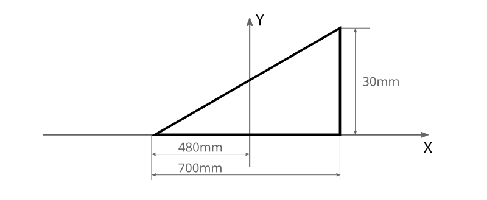
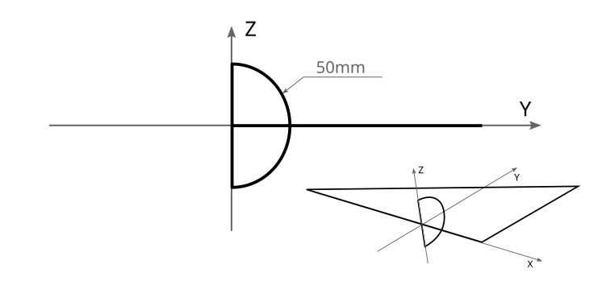
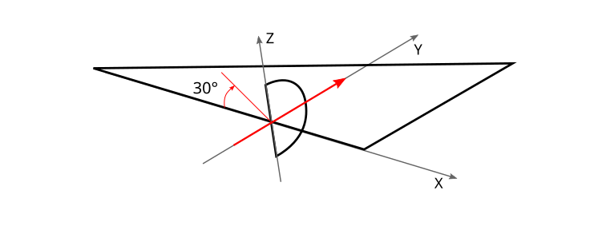
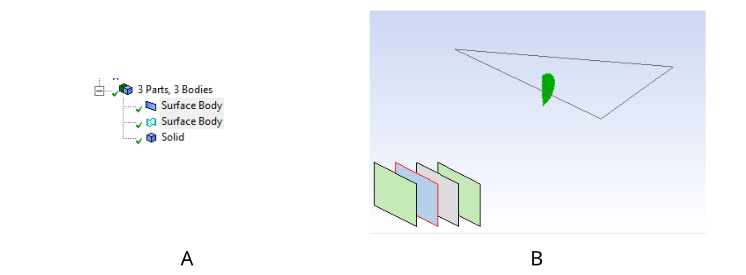
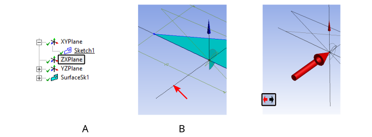
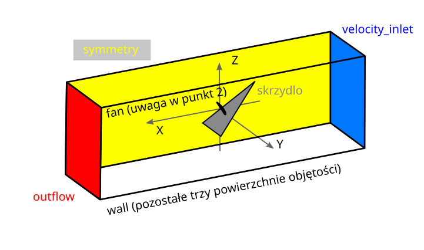
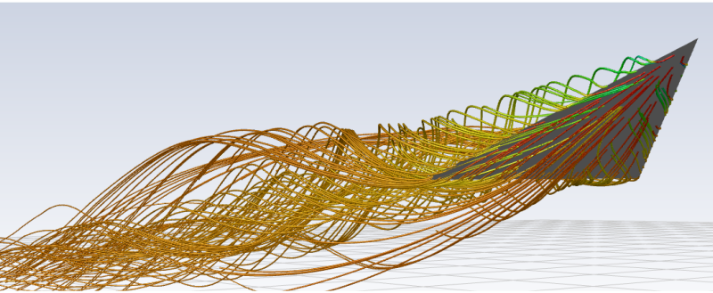
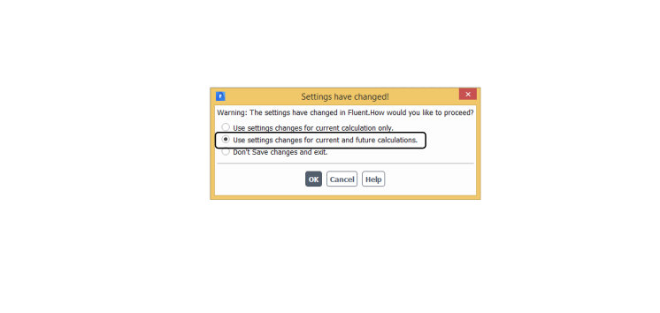

# Objective

The objective of this exercise is to introduce the modelling of three-dimensional flows and the graphical post-processing of three-dimensional simulation results.

# Overview

The task is to calculate the flow around a delta wing at a high angle of attack (30°), equipped with a propeller mounted in a slot.
The flow is confined within a wind tunnel and has a plane of symmetry.
The tunnel dimensions are 150x200x600 cm.
The working fluid is air, with a velocity of V=10m/s and a pressure of p=101325 Pa.
The geometry considered in this exercise is a half-model, representing only one half of the delta wing and one half of the propeller disc.
The flow is therefore assumed to be symmetric about the XZ plane.

# Procedure

## Geometry

1. In Workbench, create a new **Fluid Flow(Fluent)** analysis system.

2. Open **DesignModeler** by right-clicking the **Geometry** cell.

3. Set the units to **centimetres**.

4. Create a new sketch on the **X-Y** plane. Draw the geometry of one half of the delta wing as shown in the figure.

5. Create a **surface** from the sketch.

6. This produces a simplified delta wing, or more precisely, one half of it. The X-Z plane will serve as the mirror plane for the wing.

7. Next, create the surface representing the equivalent **propeller**.

8. Create a sketch on the **Y-Z** plane.

9. Within the sketch, use **Arc by Center** to create a semicircle as shown in the figure.

   NOTE: The perimeter must be closed to create the propeller surface.

   Remember to close the semicircle with a straight line.

10. Create a **surface** from the sketch.

11. The delta wing is currently at an angle of attack of 0°. Increase its angle of attack by 30 degrees.

    From the **Create** menu, select **Body Transformation**, followed by **Rotate**.

    

    **Select the geometry** to be rotated using either of the following methods (see the figure):

    - Hold **Ctrl** and select the required entities in the final item of the history tree.
    - Select the surfaces in the graphics window.

    If several entities lie beneath the cursor during selection, a graphical representation of these entities appears in the lower-left corner of the graphics window.
    The entities are represented as **layers**.
    The leftmost layer represents the entity closest to the viewer, while the rightmost layer represents the most distant entity.
    Hovering over a layer highlights the corresponding entity.
    Click the appropriate **layer** to select the required surface (see the figure).

    

    Select the **delta wing** and the **rotor**.

    Next, **select the axis of rotation** using either of the following methods (see the figure):

    

    - In the **plane list** in the history tree, where the sketches are located, select the **plane perpendicular** to the required axis of rotation.
    - In the **graphics window**, click the appropriate dashed line representing a coordinate axis.

    The coloured coordinate triad in the lower-right corner of the graphics window is used only to manipulate the camera.

    After an axis has been selected, **axis-direction arrows** appear in the graphics window. Click to set the required orientation of the axis of rotation.
    Orient the axis so that the rotation raises the nose of the wing towards the *Z* axis.

    Enter the rotation angle for the surfaces.

    Click **Generate**.

12. The final geometry construction step is to create the air volume.

13. From the **Create** menu, open **Primitives** and select **Box**.

    | --- | Origin | Diagonal components |
    | --- | ------ | ------------------- |
    | X | -250 cm | 600 cm |
    | Y | 0 cm | 150 cm |
    | Z | -80 cm | 200 cm |

    Set **Operation — Add Frozen**.

    Click **Generate**.

    If the body is not transparent after using **Add Frozen** and obscures the other geometry, select View -> Wireframe from the context menu to switch to a wireframe display.

14. Combine the created entities into a **part**. Select all entities in the body list at the bottom of the history tree, right-click, and select **Form New Part**.

---

Optional Extension

15. Create another **Box**.

    | --- | Origin | Diagonal components |
    | --- | ------ | ------------------- |
    | X | 0 cm | 200 cm |
    | Y | 0 cm | 35 cm |
    | Z | -20 cm | 35 cm |

    Set **Operation — Add Frozen**.

    Click **Generate**.

    Do not include this body in the part created in step 14. After step 14, there should be one part and one separate solid body.

---

16. **Close** DesignModeler.

## Computational Mesh

1. Open the **Mesh** module.

2. First, assign names to the boundaries (see the figure). **In a three-dimensional analysis, boundary conditions are applied to surfaces**.
   Surfaces are selected in the same way as in DesignModeler.
   After selecting a surface, press **n** on the keyboard and enter the boundary name.

   **NOTE:** DesignModeler has divided the propeller surface into two parts. In the top menu, open **Display** and use **Direction** under **Edge** to display the edge directions.
   This allows you to check whether both surfaces have the same orientation, using the right-hand rule. The orientation of the propeller surface is important for the calculation.

   - If both surfaces have the same orientation, select them together and assign a single name.
   - If the surfaces have different orientations, name them separately using numerical suffixes: fan_1 and fan_2.

3. Proceed to the mesh settings.

4. Select **Mesh** in the history tree:

   - Under **Defaults**, ensure that **Physics Preference** is set to **CFD**.
   - Under **Sizing**, enable **Capture Curvature**, since the rotor surface is circular.

5. Generate the mesh. Verify that the wing geometry is represented correctly.

6. Select the wing surface and the rotor surface. Create a **Sizing** control for these surfaces:

   - Type: **Element Size**.
   - Element size: **10 mm**, or **20mm** for less powerful computers.
   - Behavior: **Hard**.

   Click **Generate**.

7. Create another **Sizing** control:

   - Under **Scope**/**Geometry**, select the body representing the air. **Ensure that you select the volume, not a surface**.
   - Type: **Sphere of Influence**.
   - Sphere Radius: **500 mm**.
   - Element size: **30 mm**, or **50mm** for less powerful computers.

   Click **Generate**.

   Examine the mesh. What has changed?

---

Optional Extension — Continued

8. Create another **Sizing** control:

   - Under **Scope**/**Geometry**, select the body representing the air. **Ensure that you select the volume, not a surface**.
   - Type: **Body of Influence**.
   - Bodies of Influence: **Select the additional volume created in step 15**.
   - Element size: **30 mm**.

   Click **Generate**.

   Examine the changes again and consider the purpose of the additional mesh refinement.

---

9. Close the **Mesh** module.

## Calculations in Fluent

1. Launch Fluent.

2. Set the initial solver options:

   - Dimension: **3d**.
   - Display Mesh After Reading.

3. Configure the analysis:

   - General:
     - Type: **Pressure-Based**.
     - Time: **Steady**.
   - Models:
     - Turbulence model: **Spalart-Allmaras**.
   - Materials:
     - Air with the default properties.
   - Cell zone conditions:
     - Ensure that air is assigned to the computational domain.
   - Boundary conditions: double-click the corresponding tree item, or open **Physics** in the top menu and select **Boundaries** under **Zones**.
     - **Inlet** — velocity: 10 m/s; turbulence intensity: 2%; turbulence length scale: 0.5 cm.
     - **Symmetry** — verify that the correct boundary condition has been assigned.
     - **Wing** — ensure that a wall boundary condition has been assigned to the wing.

       When the boundary type is set to **wall**, note that Fluent creates a second surface. Consider why this occurs.

     - **fan**:
       - Check the direction of the normal to the rotor surface, specifically the X component of the normal vector. If the normal points in the wrong direction, select **Reverse Fan Direction**.
       - In the **Pressure Jump (unit)** drop-down menu, select **constant**.
       - Initially, perform the calculation without propeller action by entering **0.0**.
     - **Outflow** — retain the default settings.

4. Configure the solver:

   - Methods:
     - Scheme: **Coupled**.
   - Monitors/Residual:
     - Retain the default convergence criteria.

5. Initialise the solution using **Standard Initialization**.

   Select the inlet as the reference boundary.

6. Run the calculation until the required convergence is achieved.
   Under Run Calculation, change only **Number of Iterations** in the **Parameters** panel.

   The computational time will be noticeably longer because the simulation is three-dimensional.

7. Generate flow visualisations for the simulation. Consider which visualisations provide the most useful information about the flow, and present them.

8. Close Fluent.
   When prompted on exit, select the second option.
   This preserves all post-processing settings, including those for visualisation and data processing.

9. Duplicate the analysis system.

10. Activate the propeller by setting the pressure jump at the **fan** boundary to **200** Pa (see step 3).

11. Initialise the solution and run the calculation until the required convergence is achieved.

12. Repeat the visualisations and compare the results with those obtained without propeller action.
