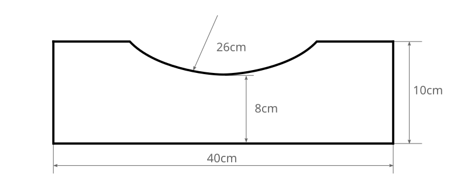
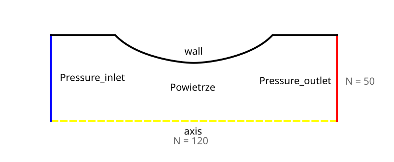
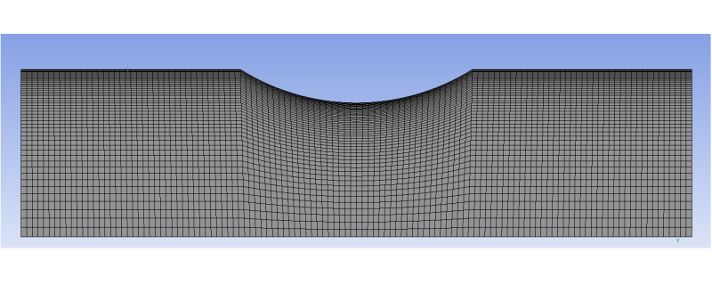
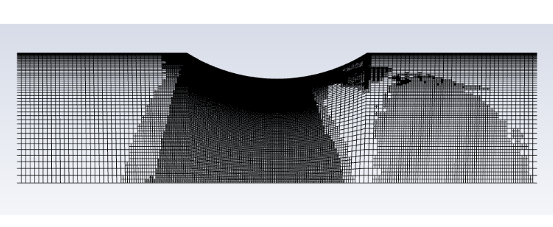

# Objective

Simulate compressible turbulent flow (Mach number > 0.3) through a converging–diverging nozzle with a circular cross-section, and become familiar with dynamic mesh adaptation.

# Overview

In this exercise, simulate steady turbulent flow using the k-\(\omega\) SST turbulence model and the density-based solver.
Treat air as an ideal gas and perform the calculations on a mesh generated during the laboratory session. First use the density-based solver, then compare the results with those obtained using the pressure-based solver.
Present the results to the laboratory instructor in the form of a report.

# Procedure

## Geometry

Create the **surface** shown in Figure 1.

## Computational Mesh

1. Assign the boundary names shown in Figure 2.

2. Specify the edge divisions shown in Figure 2.

3. When specifying the vertical edge divisions, apply biasing so that the mesh is refined towards the **wall** boundary.

4. Apply **Mapped Meshing** to the *Powietrze* surface, as in [Laboratory Instructions I](http://ccfd.github.io/courses/momp_lab01.html).

5. Adjust the mesh settings to obtain a mesh similar to that shown in Figure 3.

   

Preview of the Completed Mesh

   

   

   

   

## Calculations in Fluent

### Subsonic Flow

1. Because the geometry is axisymmetric, only the upper half of the nozzle will be modelled. In the display options, select the appropriate symmetry plane to display the lower half of the domain as well.

2. For convenience, change the pressure units to atmospheres using **Setup / General / Units...**, or **Physics / General... / Units...** in the top menu.

3. Select the density-based solver under **Setup / General**. This solver can be used for compressible, transonic flows without low-velocity regions.
   If the velocity is low over a large part of the flow domain, use the pressure-based solver instead, for example for flow around an aerofoil or an aircraft.

4. Enable the appropriate **turbulence model**.

5. Since compressible flow involves substantial temperature variations, enable the **energy equation**. It is enabled automatically when the appropriate fluid properties are selected.

6. The working fluid is air. Set its density model to **ideal-gas**.

7. Configure the boundary conditions by double-clicking **Boundary conditions** under **Setup**, or by selecting **Physics/Zones/Boundaries** in the top menu.

   a. Under **Operating Conditions...**, set **Operating Pressure (unit)** to 0 atm. With zero operating pressure, the boundary pressure values correspond to absolute pressures.

      Consult Section 8.14 of the *Fluent User's Guide*, or another Fluent guide, for the definition of operating pressure.

   b. Inlet: use pressure inlet when the inlet pressure is known but the inlet velocity and mass flow rate are unknown.

      1. Gauge Total Pressure: 0.9 [atm] (stagnation pressure).
      2. Supersonic/Initial Gauge Pressure: 0.7369 [atm]. This specifies the inlet static pressure if the flow becomes locally supersonic. It is also used to calculate the initial pressure, temperature, and velocity when the inlet is selected for solution initialisation.
      3. Turbulence intensity: 1.5%; viscosity ratio: 10.

   c. Outlet: for subsonic flow, pressure outlet allows the static pressure at the outlet of the computational domain to be specified.

      1. Gauge pressure: 0.7369 [atm].
      2. Backflow turbulence intensity: 1.5; viscosity ratio: 10.

8. Under **Solution / Methods**, select first-order schemes in all discretisation fields.

9. Under **Solution / Controls**:

   1. Set the Courant number to 50. When preparing the report, determine what the Courant number represents and provide its definition.
   2. Under **Limits...**, set the minimum static temperature to 200 K and the maximum to 400 K. Imposing solution limits reduces the likelihood of divergence caused by unrealistically large or small values.

10. To monitor solution convergence, track the difference between the outlet and inlet mass flow rates:

    1. Open **Solutions / Report Definitions**.
    2. Select **New / Surface Report / Mass Flow Rate...**.
    3. In the report definition window, **enter a name** and select **both the inlet and the outlet of the domain**.
    4. Confirm the settings.

11. Disable the residual convergence criterion by setting **Convergence Criterion = none** under **Solution / Monitors / Residual**.
    This option becomes available after selecting **Show Advanced Options**.

12. Under **Solution / Monitors**, create a new report plot using **Report Plots**:

    1. Click **New...**.
    2. Assign an appropriate name to the plot.
    3. Select the previously defined report and click **Add>>** to add it to the plot.
    4. In the plot options, specify:
       - The title to be displayed on the plot.
       - The Y-axis label, identifying the monitored variable.
       - The window in which the plot will be displayed; the default setting may be retained.
    5. Select **Print to Console** to monitor convergence more precisely.

13. Start the calculation and monitor convergence of the mass flow rate difference. The plot you have defined is available in the second tab of the graphics window.

    Monitor convergence using both the displayed mass flow plot and the values printed in the console at the bottom of the application window.

    Identify the console column containing the variable you defined.

    Stop the calculation once the mass flow rate difference has converged towards zero, with fluctuations on the order of 1e-6.

14. To obtain the difference between the inlet and outlet mass flow rates, open **Results / Reports / Fluxes** and select the appropriate surfaces.

15. Assess whether the numerical results are physically reasonable using engineering judgement.
    Plot the pressure along the axis of symmetry and across the narrowest section of the nozzle. Save the plots as both images and datasets. Generate pressure and Mach number contours, check for flow separation using streamlines or vectors, and determine whether the local flow velocity exceeds the speed of sound. Produce suitable visualisations.

### Supersonic Flow

1. Perform a simulation with an increased nozzle inlet pressure (gauge pressure = 1.1 atm). The flow is now expected to become locally supersonic, with velocities substantially exceeding the speed of sound.

### Pressure-Based Solver

1. Repeat the simulations using the pressure-based solver for the same two inlet pressures and compare the results. Differences are most easily identified by displaying the results from both cases on the same plot.

### Supersonic Flow — Mesh Adaptation

Perform the calculations with an inlet pressure of 1.1 atm using the density-based solver. Compare the results with the cases without mesh refinement and with the density-based solver without mesh refinement.

1. To resolve the equations accurately in regions with abrupt changes in flow variables, enable automatic mesh refinement using **Domain / Adapt / Automatic...** in the top menu and configure the following settings.

   Initialise the solution before proceeding.

   1. Create a coarsening criterion using **Cell registers / New / Field Variable...**:

      - Name the criterion **Coarsen**.
      - Select **Cell less than** as the type.
      - Set **Derivative Option** to **Gradient**.
      - Enter **0.3** under **Cells having value less than**.
      - Select static pressure under **Gradient of**.
      - Under **Scaling Option**, select **Scale by Zone Average**. The gradient will be compared with the local mean velocity.
      - Click **Save**.

      This criterion marks cells in which the static pressure gradient is below 0.3.

   2. Create a refinement criterion using **Cell registers / New / Field Variable...**:

      - Name the criterion **Refine**.
      - Select **Cell more than** as the type.
      - Set **Derivative Option** to **Gradient**.
      - Enter **0.7** under **Cells having value more than**.
      - Select static pressure under **Gradient of**.
      - Under **Scaling Option**, select **Scale by Zone Average**. The gradient will be compared with the local mean value.
      - Click **Save**.

      This criterion marks cells in which the static pressure gradient is above 0.7.

   3. Under **Frequency(Iteration)**, specify an **interval** of 100 iterations. Mesh adaptation will occur once every 100 iterations.

   4. Under **Refinement Criterion**, select **Refine**.

   5. Under **Coarsening Criterion**, select **Coarsen**.

   6. Open **General Adaption Controls** and set **Maximum Refinement Level** to **2**.

   7. Save the simulation case at this stage. Mesh modifications made by Fluent are irreversible. If the modified mesh is unsatisfactory, the procedure will have to be restarted from the beginning.

2. Start the calculation and monitor convergence of the mass flow rate difference.

3. Mesh adaptation should occur after exactly 100 iterations, according to the settings in step 1.3 of this section. To check that the procedure is working correctly, interrupt the calculation after approximately 110 iterations.
   Inspect the mesh.
   Visible regions of mesh refinement or coarsening indicate that dynamic mesh adaptation has been configured correctly.
   Otherwise, repeat the adaptation setup in step 1 of this section.

   

Preview of the Completed Mesh

   

   

   

   

4. Continue the calculation. With an adapted mesh, convergence of the mass flow rate difference may be less smooth. Stop the calculation when a satisfactory level of convergence has been achieved.

5. Analyse the results.
